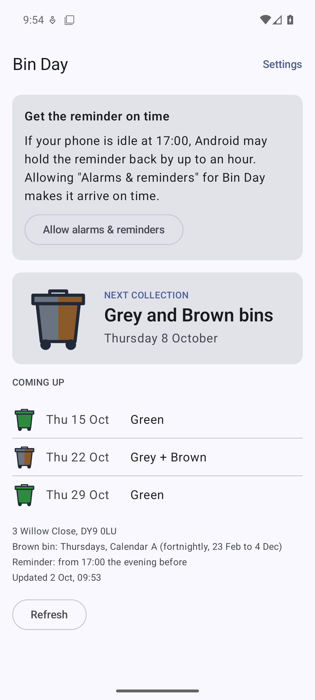
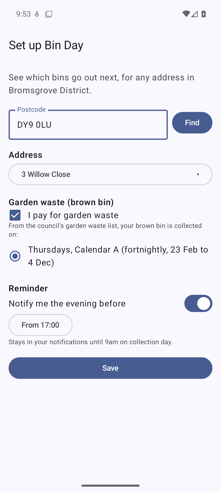
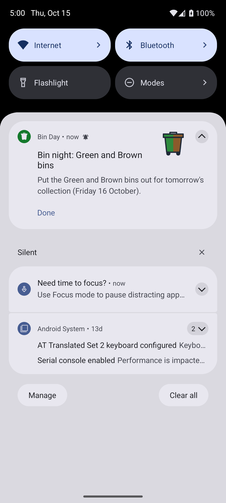

# Bin Day for Android

Which bins go out next, for any address in Bromsgrove District, with a
reminder in your notifications from the evening before.

<p>
  
  
  
</p>

- Enter your postcode, pick your address, and say whether you pay for garden
  waste. Your brown bin's day and calendar come from the council's own
  garden waste street list.
- The home screen shows the next collection and the weeks after. From 9am on
  collection day it shows the bin lorry: the van's been.
- From your chosen time on the evening before (5pm by default), a notification
  stays in the bar showing which bins to put out, drawn in their colours. It
  clears itself at 9am on collection day, or tap **Done**.

The Android status bar shows every app's small icon as a white silhouette, so
the bin colours appear in the notification itself rather than in the bar.

## Install

1. On your phone, download `bin-day-<version>.apk` from the
   [latest release](../../releases/latest).
2. Open it. Android asks you to allow installs from your browser or Files app
   once; allow it, then tap **Install**.
3. Open Bin Day and set up your address. Allow notifications when asked.
4. For the reminder to arrive exactly on time, tap **Allow alarms & reminders**
   on the home screen. Without it, Android may hold the reminder back by up to
   an hour while the phone is idle.

Updates install over the top and keep your settings.

## How it works

- Schedule: `bincollections.bromsgrove.gov.uk`, the council's bin dates site,
  looked up by postcode then property. Refreshed every 6 hours; if the council
  is unreachable the last dates fetched are kept.
- Brown bins aren't on that site, because garden waste is a paid extra. They
  come from the council's
  [garden waste street list](https://www.bromsgrove.gov.uk/residents/my-place/bins-and-recycling/garden-waste-service/garden-waste-collection-dates-2026/)
  and the 2026 calendars (A: fortnightly w/c 23 Feb to w/e 4 Dec; B: w/c 2 Mar
  to w/e 11 Dec; C: A's weeks, ending w/e 20 Nov).
- **Each January**, update `GardenCalendar` in `core/Collections.kt` and
  `Council.GARDEN_STREETS_URL` from the council's new leaflets. Until then no
  brown dates are added for the new year.
- Nothing is sent anywhere except requests to those two council sites.

This is a port of the [Bin Day Chrome extension](https://github.com/dirk1978/bin-day-extension);
the parsing and date logic in `core/` mirrors its `lib.js` and is tested
against the same saved council pages.

## Building

Needs JDK 17 and the Android SDK (API 36).

```bash
./gradlew testDebugUnitTest   # JVM unit tests for core/
./gradlew assembleDebug       # app/build/outputs/apk/debug/
./gradlew assembleRelease     # signed if BIN_DAY_SIGNING points at a key, see app/build.gradle.kts
```

Code layout:

- `core/`: council page parsing, garden waste calendars, the collection and
  9am rules. Plain Kotlin, no Android types.
- `data/`: the council HTTP calls, and settings plus the cached schedule in DataStore.
- `notify/`: the reminder (alarm, notification, receivers) and the 6-hourly refresh worker.
- `ui/`: Compose screens and the bin/lorry drawings.

`.claude/skills/` holds Google's Android agent skills for Claude Code
(installed with `android skills add <name> --agent=claude-code`).
